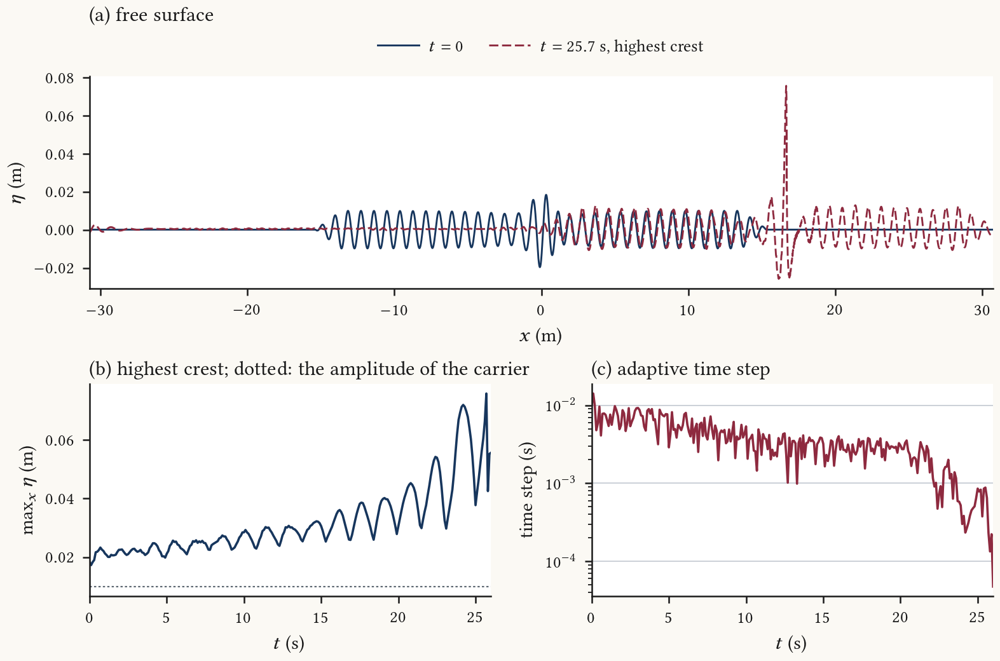

<!-- Author: Dr. Denys Dutykh (Mathematics Department, Khalifa University of Science and Technology, Abu Dhabi, UAE) -->

# ConformalEulerDeepWater: the full Euler equations of water waves in deep water, in conformal variables



The run of `run_Euler.m`, computed in GNU Octave: the Peregrine breather of the wave-tank experiment of Shemer and
Alperovich (2013), with the carrier period 0.587 s (wavelength 0.538 m) and the amplitude 10 mm, followed from the
wavemaker to 9 m, the distance at which the Peregrine solution has its maximum. Panel (a) shows the free surface
around the centre of the group, at the distance x − cg t from it, when the centre leaves the wavemaker and when it
passes the wave gauges at 2.25 m, 6.25 m and 9 m, each record shifted by 40 mm as in Figure 1 of the article: the
hump of the wave train grows into a crest 30 mm high, 0.8 m ahead of the centre. Panel (b) shows the highest crest
met at each distance from the wavemaker, as a gauge placed there would record it, with the crests measured at the
three gauges and the envelope of the Peregrine solution. The computed crest oscillates along the tank with the
period λ0, as the carrier slides through the envelope; near the wavemaker it also carries the adjustment of the
initial wave train, which has no bound harmonics. Panel (c) shows the relative changes of the energy, of the momentum
and of the mass, the last one divided by ζ0 times the length of the group.

ConformalEulerDeepWater is a set of MATLAB scripts, which also run in GNU Octave, that solve the full Euler equations
of irrotational surface gravity waves on water of infinite depth (deep water). The time-dependent fluid domain is
mapped conformally onto a fixed half-plane, a technique pioneered by L. V. Ovsyannikov and developed by Dyachenko,
Kuznetsov, Spector and Zakharov (1996), and the equations are solved by a Fourier pseudo-spectral method with an
exponential filter, exact integration of the linear terms and an adaptive embedded Runge–Kutta scheme. The example is
the Peregrine breather, the prototype of extreme (rogue) waves, in the wave-tank experiment of Shemer and Alperovich
(2013), initialised, like their wavemaker, from the Peregrine solution. No article accompanies the code: the
software itself is cited (see How to cite).

## The problem

The fluid is ideal and incompressible, the flow irrotational and two-dimensional, the depth infinite, and gravity
g = 9.81 m/s² acts alone; all quantities are in SI units. The fluid domain is mapped conformally onto the lower
half-plane of a variable ξ + iζ, so that the free surface becomes x(ξ, t) + iη(ξ, t). The unknowns are the elevation
η(ξ, t) and the velocity potential φ(ξ, t) at the surface, which obey

```text
η_t = η_ξ H[ψ_ξ / J] − x_ξ ψ_ξ / J,
φ_t = φ_ξ H[ψ_ξ / J] − (φ_ξ² − ψ_ξ²) / (2J) − g η,
x = ξ − H[η],     ψ_ξ = H[φ_ξ],     J = x_ξ² + η_ξ²,
```

where ψ is the stream function at the surface and H is the Fourier multiplier of symbol i sign(k) in ξ (a Hilbert
transform, with this sign). The linear part of these equations, whose waves obey ω² = g|k|, is integrated exactly in
Fourier space (an integrating factor), and the nonlinear part is computed on the grid.

The functions are expanded on N = 16384 Fourier modes of the periodic interval −l < ξ ⩽ l, with l = 35 λ0 = 18.83 m.
After every step the spectrum is multiplied by the exponential filter exp(−5 (|k|/k_c)¹⁵), with k_c = 0.6 times the
largest wavenumber, a filter of the kind proposed by Hou and Li (2007). Time is advanced by the embedded Runge–Kutta
scheme of order 5(4) of Cash and Karp (1990), written, as in the method of Lawson (1967), for the variable
w(s) = exp(−sL) u(t + s), where u collects the Fourier coefficients of η and φ and L is the linear part: each stage
evaluates the nonlinear terms at the physical state exp(sL) w, and each step ends with the exact linear rotation over
the step just taken. The step is chosen by a PI control (Hairer and Wanner, 1996) with the tolerance 5 × 10⁻¹⁰.

The initial wave train is that of the experiment of Shemer and Alperovich (2013), in a tank 18 m long with water
0.6 m deep (k0 h = 7, deep water for the carrier): the carrier period T0 = 0.587 s, hence the frequency
ω0 = 10.70 rad/s, the wavenumber k0 = ω0²/g = 11.68 m⁻¹, the wavelength λ0 = 0.538 m and the group velocity
cg = 0.458 m/s; the amplitude ζ0 = 10 mm far from the hump, that is a0 = ζ0/√2 = 7.07 mm and the steepness
ε = a0 k0 = 0.0826 (ζ0 k0 = 0.117). Its envelope is the Peregrine solution of the spatial nonlinear Schrödinger
equation, written as in equations (1), (2) and (4) of the article:

```text
ζ(x, t) = Re[ a0 A(η, ξ) exp(i(k0 x − ω0 t)) ],
A(η, ξ) = −√2 [ 1 − 4(1 − 4iη) / (1 + 4ξ² + 16η²) ] exp(−2iη),
ξ = ε ω0 (x/cg − t),     η = ε² k0 (x − X0),
```

where x is the distance from the wavemaker and X0 = 9 m. The envelope is 1.37 ζ0 high at the wavemaker (η = −0.717)
and would reach its maximum 3 ζ0 at x = X0, at the time X0/cg = 19.64 s. As in the experiment, the group lasts
70 periods and is tapered over its first and last two: in space it occupies 35 λ0, half of the domain, with linear
tapers one wavelength long. The run starts at t = 0, when the centre of the group leaves the wavemaker, and ends at
Tf = Xend/cg, when the centre has travelled Xend = X0 = 9 m, so Tf = 19.64 s. The elevation is transferred to the
conformal variable by a fixed-point iteration (tolerance 10⁻¹⁴), the calm water outside the group lies at η = 0, and
the potential is that of linear waves, φ̂ = −i sign(k) √(g/|k|) η̂.

The run stops at 9 m because the computation stays far from breaking up to there: the steepest slope of the surface
is 24° and the horizontal velocity at the crest 0.46 m/s, half the phase speed 0.92 m/s of the carrier. The
experiment went on to 13.3 m, and its authors observed waves on the verge of breaking. Followed that far
(`Xend = 13.3`), the computation enters the onset of breaking: the slope of the crests passing through the peak of the
group exceeds 45° near 11 m, the exponential filter then removes energy (3.3% by 13.3 m with N = 16384, 3.9% with
N = 32768), and with N = 32768 the surface overturns at 12.2 m, where the conformal description ends.

## Quick start

From the folder `scripts/`, in MATLAB or GNU Octave:

```matlab
cd scripts
run_Euler
```

The script takes no argument; its parameters are set at its top. It draws the free surface and the Fourier spectrum
of its elevation about sixteen times per carrier period, keeps the mass, the momentum and the energy at the same times
in the variables `Time`, `Mass`, `Moment` and `Energy`, and prints at the end the mass and the largest relative
change of the energy. Setting `compute_velocities = true` computes, at the same times, the velocities `U` and `V` at
the surface and their horizontal derivatives `U_x` and `V_x`, whose formulas are derived in `doc/VelocityField.pdf`.
In GNU Octave 11.1, on one processor thread, the run takes about 110 s with the drawing, and the time step chosen
by the control stays between 7 × 10⁻⁴ s and 10⁻² s.

## Contents

| Path | Content |
|---|---|
| `scripts/run_Euler.m` | the main script: parameters, initial breather, time loop, mass, momentum, energy and the optional surface velocities |
| `scripts/RHS.m` | the nonlinear right-hand side of the equations in conformal variables, at the time of a Runge–Kutta stage |
| `scripts/turn.m` | the exact integration of the linear terms, with the exponential filter |
| `scripts/Conf2Real.m` | the physical abscissa x = ξ − H[η] of the surface |
| `scripts/Plot.m` | the drawing of the free surface and of its spectrum |
| `doc/VelocityField.tex`, `doc/VelocityField.pdf` | the derivation of the surface velocities and of their gradients in conformal variables, by Francesco Fedele and Denys Dutykh |
| `pics/PB_shot.png` | the drawing of `Plot.m` at the start of the run, shown by the first version of this page |
| `docs/figures/` | the scripts of the figure of this page |

The figure is made by two scripts, run from `docs/figures/` in this order. The first, `conformal_readme_data.m`
(GNU Octave or MATLAB, about 80 s), runs `run_Euler.m` as it stands from the folder `docs/figures/recording/`, whose
`Plot.m` records the free surface instead of drawing it: at every output time, the elevation at the gauges and the
highest elevation met so far at every distance from the wavemaker, found between two output times from the values
and the time derivatives of the elevation (cubic Hermite interpolation). The second, `plot_readme_figure.py`
(Python 3 with NumPy, Matplotlib and Pillow, and the style file beside it), draws the figure.

## Version 1.2.0: what changed

The run of version 1.1.0 practically stalled: at t = 25.7 s the highest crest reached 77 mm (k0 η = 0.55, for the
former carrier of period 0.75 s), the time step fell below 10⁻⁴ s, and after five minutes of computing in GNU Octave
the run had reached t = 28.0 s of the 223.2 s requested. The cause was the time step, not the physics, and two
defects are corrected. First, the stages of the Runge–Kutta scheme evaluated the nonlinear terms at the stage value
w itself, in the rotated variable, instead of the physical state exp(sL) w: the scheme was only of first order, and
it fed energy into the waves, by 10% in the first 10 s and by 50% in 26 s, which drove the breather into a spurious
steep crest before the run broke down (the energy grew sevenfold at t = 27.4 s). The first version of the code
(2014) evaluated the stages correctly; version 1.2.0 restores it. Second, the exact linear rotation that ends each
step used the step proposed for the next step instead of the step just taken, so that the linear part of the
dynamics ran ahead of the clock, by 0.66 s at t = 27.6 s. With both corrections the former setting runs without
difficulty: 60 s of physical time in 149 s of computing, with a highest crest of 32 mm (k0 η = 0.23) and the energy
conserved to 9 × 10⁻⁷.

The final time was written `Tf = 95*T0*sqrt(g)`, which is not a time (its unit is the square root of a metre); it is
now Tf = Xend/cg, the time the group takes to travel Xend. The physical setting is now the published experiment,
whose carrier period, amplitude, focusing distance and group duration the script takes from the article, instead
of an undocumented setting with a carrier of period 0.75 s focused 17.7 m away. The envelope follows equation (4) of
the article, with its sign; the calm water outside the group lies at η = 0, whereas removing the mean of η over ξ,
as the former script did, raises it by 0.28 mm for this wave train; and the drawing function `Plot.m` now runs in
GNU Octave 11 (full property names, italic titles, no zero wavenumber on the logarithmic axis).

## How the corrected solver was checked

The order of the time scheme was measured with constant steps over the first second of the run, against the
classical Runge–Kutta scheme of order four in the original variables with a step of 0.25 ms. The scheme of version
1.1.0 is of first order: its error in η is 9.8, 4.7, 2.3 and 1.1 × 10⁻⁴ m for steps of 10, 5, 2.5 and 1.25 ms, about
5% of the amplitude after one second at the steps of a few milliseconds that the control chooses. The corrected
scheme is accurate to 1.7 × 10⁻⁸ m with a step of 10 ms, the level at which the filter, applied once per step, makes
the result depend on the number of steps; without the filter, over half a second and against a reference step of
0.0625 ms, its error is 2.6 × 10⁻⁶, 7.6 × 10⁻⁸, 2.3 × 10⁻⁹ and 7.1 × 10⁻¹¹ m for steps of 5, 2.5, 1.25 and 0.625 ms,
divided by 35, 33 and 32 at each halving: the order is five.

Over the default run the energy (the Hamiltonian of the conformal formulation) changes by 7.5 × 10⁻⁶ of its value,
the momentum by 8.4 × 10⁻⁶, and the mass by 1.0 × 10⁻⁷ m², against ζ0 × 35 λ0 = 0.19 m²; most of the change comes in
the last half second, when the steepest crest passes, and with N = 32768 the change of the energy falls to
3.3 × 10⁻⁷. The highest elevation of the run is 30.4 mm with both N = 16384 and N = 32768. The computed highest crests
at the gauges at 2.25 m, 6.25 m and 9 m are 17.0, 19.1 and 25.7 mm, against 14.2, 20.1 and 25.2 mm measured by
Shemer and Alperovich (2013): at the distance of the maximum of the Peregrine solution the two agree within 2%, and
both stay below the 30 mm of its envelope, since the measured growth, like the computed one, is slower than the
Peregrine solution predicts. At 2.25 m the computed crest exceeds the measured one by 20%: the computed crests
there still carry the adjustment of the initial wave train, set without its bound harmonics, while the measured
crest is lower even than the envelope of the Peregrine solution, 15.6 mm.

## Requirements

MATLAB or GNU Octave (tested with Octave 11.1); no toolbox is needed. The figure scripts need Python 3 with NumPy,
Matplotlib and Pillow.

## How to cite

No article accompanies this code, so please cite the software itself:

D. Dutykh, ConformalEulerDeepWater: the full Euler equations of water waves in deep water, in conformal variables, by
a Fourier pseudo-spectral method, version 1.2.0 (2026).

https://github.com/dutykh/ConformalEulerDeepWater

```bibtex
@software{Dutykh_ConformalEulerDeepWater,
  author = {Dutykh, Denys},
  title = {{ConformalEulerDeepWater}: the full {Euler} equations of water waves in deep water, in conformal variables, by a {Fourier} pseudo-spectral method},
  year = {2026},
  version = {1.2.0},
  url = {https://github.com/dutykh/ConformalEulerDeepWater},
  license = {MIT}
}
```

The button "Cite this repository" in the right-hand column of this page gives the same reference, read from
`CITATION.cff`. The code rests on the following works, which deserve credit wherever it is used:

| Work | Used for |
|---|---|
| A. I. Dyachenko, E. A. Kuznetsov, M. D. Spector and V. E. Zakharov, Analytical description of the free surface dynamics of an ideal fluid (canonical formalism and conformal mapping), Physics Letters A 221, 73–79 (1996), [doi:10.1016/0375-9601(96)00417-3](https://doi.org/10.1016/0375-9601(96)00417-3) | the equations in conformal variables |
| D. H. Peregrine, Water waves, nonlinear Schrödinger equations and their solutions, The Journal of the Australian Mathematical Society, Series B 25, 16–43 (1983), [doi:10.1017/S0334270000003891](https://doi.org/10.1017/S0334270000003891) | the Peregrine breather |
| L. Shemer and L. Alperovich, Peregrine breather revisited, Physics of Fluids 25, 051701 (2013), [doi:10.1063/1.4807055](https://doi.org/10.1063/1.4807055) | the experiment, its parameters and the initial breather |
| T. Y. Hou and R. Li, Computing nearly singular solutions using pseudo-spectral methods, Journal of Computational Physics 226, 379–397 (2007), [doi:10.1016/j.jcp.2007.04.014](https://doi.org/10.1016/j.jcp.2007.04.014) | the exponential filter |
| J. D. Lawson, Generalized Runge–Kutta processes for stable systems with large Lipschitz constants, SIAM Journal on Numerical Analysis 4, 372–380 (1967), [doi:10.1137/0704033](https://doi.org/10.1137/0704033) | the integrating factor in the Runge–Kutta stages |
| J. R. Cash and A. H. Karp, A variable order Runge–Kutta method for initial value problems with rapidly varying right-hand sides, ACM Transactions on Mathematical Software 16, 201–222 (1990), [doi:10.1145/79505.79507](https://doi.org/10.1145/79505.79507) | the embedded Runge–Kutta scheme |
| E. Hairer and G. Wanner, Solving Ordinary Differential Equations II. Stiff and Differential-Algebraic Problems, Springer (1996), [doi:10.1007/978-3-642-05221-7](https://doi.org/10.1007/978-3-642-05221-7) | the PI control of the time step |

## Version history

Version 1.0, the tag `v1.0` of May 2025, holds the solver with the computation of the surface velocities contributed
by Francesco Fedele. Version 1.1.0 (November 2026) left the solver unchanged and documented it: the equations and the
parameters of the breather, a figure with the scripts that make it, the citation file and the credits. Version 1.2.0
(November 2026) corrects the time step, takes the physical setting from the experiment of Shemer and Alperovich
(2013) with a final time that is a time, and redraws the figure from the corrected run (see the two sections above).

## Licence

MIT licence (see `LICENSE`).

## Author and acknowledgements

Denys Dutykh (Mathematics Department, Khalifa University of Science and Technology, Abu Dhabi).

https://www.denys-dutykh.com/

Comments, questions and reports of errors are welcome. The author thanks the colleagues who helped to develop the
solver: Didier Clamond (Université Côte d'Azur, Laboratoire J.A. Dieudonné, Nice), for the conformal method and its
implementation; Bernard Ee (Tel Aviv University, School of Mechanical Engineering), for the initialisation of the
Peregrine breather and its validation; Francesco Fedele (Georgia Institute of Technology, Atlanta), for the module
that computes the surface velocities and their derivatives, and for the first draft of `doc/VelocityField.tex`; and
Lev Shemer (Tel Aviv University, School of Mechanical Engineering), for the theory of the Peregrine breather and its
experimental validation.
